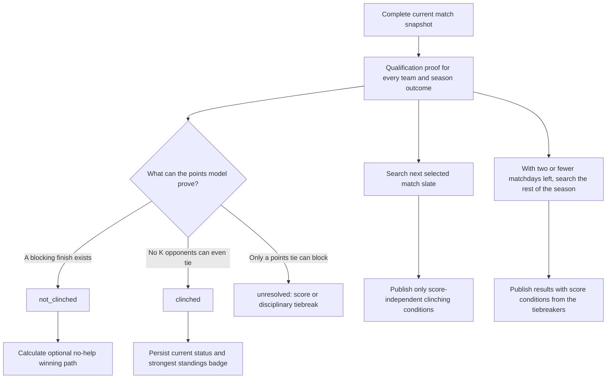
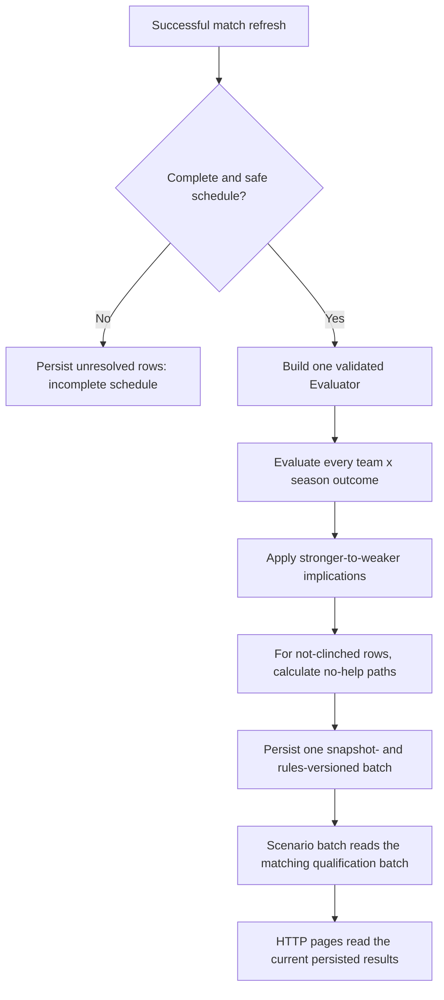
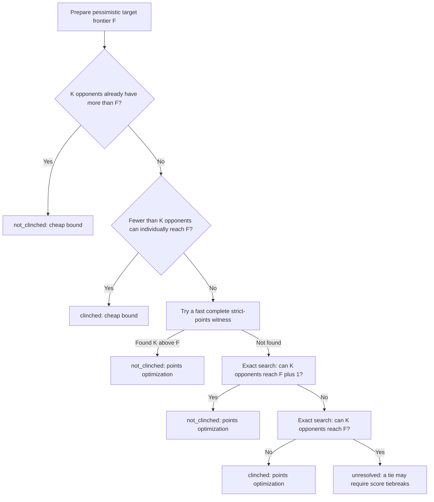
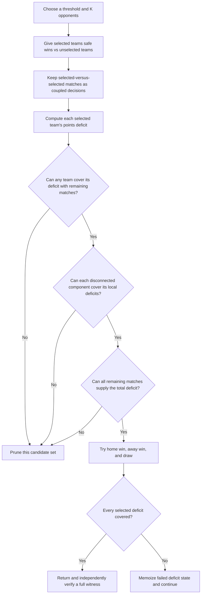
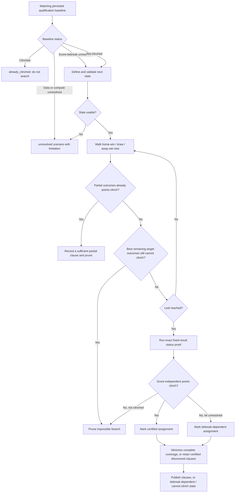

# How clinching works

This is the guide to the **current** qualification and clinching-scenario
implementation. It is deliberately layered: start with the short version, then
follow the proof flow or the implementation details as needed.

## The short version

For any season outcome with a top-`K` place threshold, a team has **clinched** only when
there is no feasible way for `K` other teams to finish ahead of it. The system
is deliberately conservative:

- `clinched` means the guarantee has been proved.
- `not_clinched` means the solver found a feasible completion that can keep
  the team below the threshold. It does **not** mean the team has been eliminated.
- `unresolved` means the system cannot honestly settle the answer from the
  available data, an outcome-only points proof, and its computation budget.

The clinching-scenarios page separately publishes a playoff-elimination scenario
when it has a stronger proof: eight opponents already have strictly more
points than the target can reach even by winning every remaining match. This
is not inferred from `not_clinched`, standings position, or a tiebreak.

The current 2026 regular-season rules are configuration, not solver constants:
16 teams, 30 matches per team, with Shield (top 1), home playoff game (top 4), and
playoffs (top 8). A stronger guarantee implies each weaker one: Shield →
home playoff game → playoffs. A team that secures a home playoff game normally
hosts the opening playoff match, but venue availability means hosting itself is not an unconditional
qualification guarantee.

The key idea is that the solver gives the target its **worst** remaining results
(losses) before evaluating its rivals. If the target is still guaranteed a
top-`K` finish from that pessimistic frontier, it is clinched.

## What must be true before a proof runs

Qualification is a derived batch, calculated after a durable match refresh;
ordinary page requests only read the persisted batch. Before any team is
evaluated, the refresher verifies:

- the match inventory has the expected teams and matches, and every
  participant has the configured number of matches;
- every match is either completed with both scores or `PreMatch` with neither
  score;
- every pending match has a valid kickoff time, so it can be put in a stable
  chronological order; and
- the configured season rules are valid.

If any check fails, every status is `unresolved` with
`incomplete_schedule`; the site does not quietly substitute a partial-table
answer. A shared qualification budget (five seconds by default) likewise
produces an explicit `compute_budget` result rather than a guess.

The result is tied to both the immutable match snapshot and the season-rule
version. This prevents a badge or scenario from being mixed with results
calculated from a different schedule or playoff format. When no scenario batch
matches the current snapshot, rules and definition version, the clinching page
says "Recalculation pending." instead of showing an older result. The standings table
shows a green badge for proved clinches and a red × marker (with a standings
key) only for a separately proved, points-only playoff elimination;
`not_clinched` alone never produces an elimination indicator.

## Status proof: the mental model

Let `F` be the target team's final points after:

1. applying completed scores and any caller-supplied fixed outcomes; and
2. making the target lose every remaining match that has not been fixed.

All remaining matches not involving the target are then the solver's
decisions. This is valid because any better target outcome can only make a
clinching proof easier. The solver asks two related questions about the target's
pessimistic frontier `F`:

- Can at least `K` opponents finish with **more than `F`** points?
- If not, can at least `K` opponents finish with **at least `F`** points?

### Why two thresholds matter

The strict query, `F + 1`, identifies a points-only way to deny the target.
One feasible assignment is enough to prove `not_clinched`.

If no `K` opponents can finish strictly above `F`, the target cannot be
denied on points alone. The level query, `F`, distinguishes the remaining
cases:

| Result of the level query | Meaning |
| --- | --- |
| Fewer than `K` opponents can reach `F` | Even a tiebreak cannot put `K` teams ahead; the team is `clinched`. |
| `K` opponents can reach `F` | A score-based or unavailable tiebreak might matter, so the status is `unresolved`, not a premature clinch. |

This is why a team may look safe in the table but not receive a clinched badge:
the system refuses to turn an unproved goal-difference, head-to-head, or
disciplinary tiebreak outcome into a mathematical claim.

## How the coupled-match solver proves the points questions

Individual maximum points are a useful screen, but they are not a proof: two
rivals playing each other cannot both receive three points from that match. The
exact solver preserves that coupling.

For each threshold and candidate set of `K` opponents, it awards selected
opponents a win against unselected opponents, gives unrelated matches a draw,
and leaves only selected-versus-selected matches as decisions. It then searches
the remaining match graph for enough points to cover each selected team's
deficit to the threshold.

The solver uses branch-and-bound with memoized deficit states. It prunes when a
team, a disconnected component, or the remaining matches collectively cannot
supply enough points. A returned blocking witness assigns every remaining match;
canonical scorelines (`1-0`, `0-0`, `0-1`) make the witness readable
without pretending those scores affected a strict-points proof.

## Tiebreaks and the completed-season exception

While matches remain, the live proof uses points only. A level-points blocking
completion is reported as `unproved_score_tiebreak`; it is not simulated using
an arbitrary score cap.

When there are no pending matches, the system calculates the official
total-points table from actual scores. Its available ordering is points, goal
difference, wins, goals scored, head-to-head points, and head-to-head goals
scored. If a final tie still reaches least disciplinary points, which is not in
the cache, the system compares the tied group's best and worst possible ranks
with each season outcome's place threshold. A tie wholly above or below the
threshold is decisive; only a tie that crosses the threshold is `unresolved` with
`missing_disciplinary_rule`. The deterministic display order used as a final
fallback is never used as an official clinching proof.

## Reading a stored qualification result

Every result carries the team, season outcome, top-`K` value, status, method,
reason, point-count evidence, optional witnesses, no-help scenario, and diagnostics.

| Method | Interpretation |
| --- | --- |
| `cheap_bound` | A linear points bound decided the answer without exact search. |
| `points_optimization` | The coupled-match solver found a strict blocker or proved neither strict nor level blockers can reach the threshold. |
| `accessible_tiebreak` | A completed season was settled from actual scores using the available official table rules. |
| `unproved_score_tiebreak` | A level-points completion exists, but future score tiebreaks were not proved. |
| `missing_disciplinary_rule` | A completed-table tie needs disciplinary points that are unavailable. |
| `compute_budget` | The shared calculation deadline expired. |
| `incomplete_schedule` | The match snapshot was incomplete, unsafe, or could not be ordered. |
| `implied_achievement` | A stronger clinch implies this weaker season outcome. |

`StrictlyAhead` and `AtLeastLevel` record either exact counts or safe
lower/upper bounds, depending on the proof path. `BlockingWitness` shows a
schedule that denies the target; `FrontierWitness` shows the level-points
completion that made the tiebreak question unresolved.

## No-help scenarios

For a `not_clinched` result, the batch also asks: *Can this team guarantee the
season outcome by winning its own next matches, regardless of every other result?*

The evaluator fixes all of the target's remaining matches as wins, in kickoff
order. If that is enough, it binary-searches the earliest successful prefix and
stores those match IDs. It does **not** claim that any arbitrary number of
wins is enough: the named matches, including their opponents, are part of the
proof.

| No-help state | Meaning |
| --- | --- |
| `guaranteed` | Winning the listed chronological prefix clinches the season outcome without outside help. |
| `impossible` | Even winning every remaining target match cannot guarantee it. |
| `unresolved` | The endpoint depended on an unresolved proof or the budget expired. |
| `not_applicable` | The team had already clinched. |

## Next-slate clinching scenarios

The scenario feature answers a different question: *Which upcoming results are
sufficient for a clinch by this slate's cutoff?* It never replaces the normal
season-long status proof.

The slate is explicit. The system uses the next matchday when its data is
reliable; otherwise it includes pending matches in the 120-hour window starting
with the next kickoff. Every usable slate is searched. The proof-directed walk
prunes branches as soon as it can certify a sufficient clinch or rule out a
possible one, and uses the independently configured scenario budget as its only
operational limit. When the budget expires, any scenarios already found remain
published because they are certified; the result also says that additional scenarios
may exist.

Only `cheap_bound` and `points_optimization` clinches are publishable
outcome-only scenarios. A scenario is tested against **every** slate
assignment it represents, then generalized where all of its outcomes are
certified. That permits honest phrases such as “does not win” while withholding
conditions that depend on goal margin or unavailable disciplinary data.

| Scenario state | Meaning |
| --- | --- |
| `already_clinched` | The baseline already proved the season outcome. |
| `can_clinch` | At least one score-independent, sufficient outcome-only scenario was certified. |
| `cannot_clinch` | All complete slate outcomes were definitively non-clinching. |
| `tiebreak_dependent` | A possible clinch may depend on scores or unavailable tiebreak data; no outcome-only scenario is published. |
| `unresolved` | The baseline, slate data, or compute budget prevented a conclusive search. |

When a `can_clinch` result has tiebreak-dependent leaves or ends at its compute
budget, the visible scenarios remain valid but may not cover every theoretical
scenario. The UI says so instead of implying that the displayed conditions are
necessary.

### Scenario presentation

A line under the page title gives the slate's local date range and expands
to list its included matches; the list stays collapsed by default so the
results remain near the top. "Already clinched" boxes list each team once,
under its highest clinched outcome, since that outcome implies the lower ones. Each team that can clinch, or can be eliminated,
gets one card: the team's name heads it, and each outcome ("Can clinch a home
playoff game", "Can clinch a playoff spot") is a section under its own badge,
ordered by outcome rank. Cards follow each team's highest-ranked outcome, then
standings position. Color carries meaning: the team's name sits on a tinted
band (green for clinching, red for elimination), each outcome badge is solid,
and each result box is tinted by the team's own result in that match: green for
a win (or win or draw), gray for a draw, amber for a loss (or draw or loss), and
neutral when it spans several matches. A sufficient own-result row ends after
its heading, with compact padding and no empty body or repeated clinch,
elimination or finish label. Requirements use the same quiet rows and subtle
separators in all three views. Logical groups still explicitly say **all of**,
**any of**, or **at least N**; a conjunction is never flattened into alternatives.
Requirement rows use fragments without terminal periods. Each alternative
starts on its own “or” line so any following score condition applies only to
that alternative. Rival results with different tiebreak requirements instead
use separate, unbulleted rows under “At least one of these conditions:”, with
the same left rule and subtle separators as other nested alternatives. The
group label aligns with its sibling requirements under “all of”; only the
alternative rows are indented. Each item
repeats the rival and fixtures; its score requirement and Tiebreak details
belong only to that item. Results with identical requirements can still merge.
Nested groups are labeled “All of:” (only for more than one
condition), “At least one of these conditions:” and “And at least one of these:”.
Explanatory paragraphs use complete sentences with capitals and periods.
Within an outcome, the page groups confirmed scenarios by the team's own results, in kickoff
order and from wins through draws to losses. Overlapping conditions such as
“win” and “win or draw” are split so the draw group includes exactly the
outside help certified for a draw. All own-result group headings and factored
requirements stay visible. Only groups whose summary is omitted for size offer
an expandable scenario list. Every essential score requirement, including all
GD, goals-scored and head-to-head equality branches, is directly visible.
A separate native **Tiebreak details** control contains supporting current-gap
arithmetic and remaining-match counts. When the requirement exceeds every
historical winning margin, one sentence at the end of that same control says
so. Its label contains no football sentence
or team fragments; keyboard focus is visible and its target is at least 44px.
Without useful supporting context it is omitted. Team crests accompany named
teams consistently in headings, fixtures, score sentences and alternatives.
Inline team codes share the surrounding sentence’s text baseline; crests are
centered beside the code without shifting neighboring words.
Inside an already named card, own-result headings omit the subject: “Win at
[HOU token]”. Multiple fixtures retain their venues and chronological order.
Fixture and score tokens come from stored IDs, never parsed display strings.
Results
from one match with identical outside help share a heading, such as “draws or
loses.” Two-match result orderings share a heading only when their outside help
is identical; for example, “one win and one loss” still names
the two specific matches. Two-match groups with identical outside help also
merge when together they are exactly every result worth at least some points
total, every ordering included: five sufficient rows for everything but two
losses become one "earns at least 1 point across both matches" heading.
For unusual slates with more than four relevant own matches, the page retains
the original, potentially overlapping own-result groups to bound expansion.

An outcome's "Every clinching scenario requires" note lists outside-match
conditions shared by all of its scenarios. It leaves out the team's own
results, which already head every result group, and is hidden when nothing
else remains.

Within a group, a visible factored summary puts common requirements once above
an “any of” list. The summary may contain overlapping alternatives when that
is shorter and clearer. A group with more than twelve summary scenarios instead
directs readers to its exact scenarios, avoiding a large nested list.
Every requirement shared by all alternatives, including a score condition,
appears once at that level; pulling out shared requirements adds no nesting.
When different results of one outside match appear in several scenarios, the
summary groups a repeated result before other shared conditions. If an earlier
scenario already covers one result of a broader condition, the summary removes
that redundant result. For Bay FC's draw scenarios, KC wins sit together;
the SEA-win alternatives then name a DEN win where applicable. Each rewrite
must preserve the certified outcome union. Alternatives with the same number
of conditions are ordered by their displayed result text, keeping repeated
results such as DEN wins adjacent regardless of match IDs.
Alternatives differing only in the allowed results of one match merge into
one condition: “ORL wins at SEA” or “SEA draws vs ORL” becomes “ORL wins or
draws at SEA”. All other requirements, including score conditions, must match;
allowing all three results removes that match's requirement. This merge runs
before points compaction for both summaries and exact scenarios, with a
256-path limit to bound presentation work.

Groups whose summary is omitted offer expandable, complete certified scenarios;
a full visible summary has no duplicate scenario disclosure.
Each exact scenario puts its requirements in separated rows joined by `AND`,
with a club crest and two- or three-letter team code; each scenario is an `OR`
alternative to the others. When alternatives for two matches of the same team
exactly equal a minimum points total, the page names both matches and that
total. This rewrite checks all nine outcome combinations and never infers an
uncertified combination from a points total. Both the summary and exact scenarios
preserve the union of stored certified scenarios, including partial results.
Repeated equivalent scenarios and stronger scenarios already covered by a weaker
one need not be displayed repeatedly.

The exact-scenario view subtracts partial overlap between outside-help scenarios before
combining results into points totals. Paths with fewer match requirements
take precedence, with a stable match-ID and outcome-mask ordering to break
ties. Each later scenario keeps only outcomes not already represented. For example,
if “SEA wins or draws at LA + UTA draws vs LA” is already shown, the additional
scenario “SEA wins or draws at LA + UTA wins or draws vs LA + SEA wins or draws at
DEN” narrows to require a UTA **win**. When two equal-length scenarios both include
the same pair of draws, that pair remains in only one alternative. Subtraction
can split a scenario into several alternatives; it never drops a unique outcome
or adds an uncertified one. Points compaction preserves this disjoint union.

The pairwise coverage pass is capped at 256 scenarios per group. Overlap
subtraction is capped at 256 scenarios, including intermediate expansion, and
65,536 subtraction operations. Larger inputs or an expansion/work overflow
retain the original certified alternatives, which can still overlap. These
limits keep presentation work bounded on ordinary cache-only page requests.

Every complete certified scenario is represented by the visible summary, or
available in its group's disclosure when that summary is omitted.
The visible summary has at most one shared-condition factoring level; the
exact-scenario view stays flat.
Unlisted matches are unrestricted. The full included schedule remains collapsed
below the results, with its date range above them. Incomplete-result notices
remain visible for both clinching and elimination scenarios. Ordinary page requests
read only cached results and do not rerun qualification or scenario discovery.
No-help paths say “Win N matches to clinch without help” (inside a team's
section card, “… to clinch” plus the outcome) and expand to list those matches. A one-match path is omitted from a card that already lists
that win as an unconditional own-result row. The separate “Clinch without help” section explains that
winning the listed matches guarantees qualification regardless of other results,
and notes that some matches fall after the current matchday.

Use `make test-clinching` for focused scenario-proof and presentation checks.
These checks also run within `make test` and CI, including exhaustive
outcome-equivalence, disjoint detailed alternatives, future-match elimination,
and summary equivalence; visually verify desktop and 390px layouts, expansion,
keyboard access, and team filtering when changing the presentation.

## Rest-of-season scenarios

Late in the season the page also answers questions such as "in which scenarios
does Portland get a home playoff game?" exactly. Once two or fewer matchdays are
left, a second batch covers **every** remaining regular-season match, so each
assignment of results is a completed season apart from scores. A points tie that
straddles a place threshold is then settled by the tiebreakers instead of being
left unpublished. The season outcomes, card layout and own-result grouping are the
same as for the next slate, but most groups state what each rival must be held to
instead of listing scenarios (see [Rival summary](#rival-summary)).

"Matchdays left" counts the distinct matchdays of the pending matches; if any
pending match lacks a matchday, it is the most matches any team has left.

### Scope and the view switch

| Matchdays left | Page |
| --- | --- |
| Three or more | Next-slate scenarios only, as before. |
| Two (penultimate matchweek) | A segmented control, **Next matchday \| Rest of season \| Seeding**, defaulting to Next matchday. The view is the `view` query value (`next-matchday`, `rest-of-season` or `seeding`). |
| One (decision day) | **Rest of season \| Seeding**, defaulting to Rest of season: the next slate is the rest of the season. Decision day means the two slates name the same matches. |

Playoff-elimination cards use the selected slate, including all remaining matches
in the rest-of-season view. There is no line claiming the list is complete. When
the rest-of-season batch for the current snapshot and rules is missing, that view
says "Recalculation pending."

### Tiebreak order and score conditions

The 2022+ order is points, goal difference, wins, goals scored, head-to-head
points and head-to-head goals scored; a tied subgroup continues to the next
criterion without restarting. With the results fixed, wins and head-to-head points
are known. Only goal difference, goals scored and head-to-head goals scored can
become **score conditions**.

Every score condition compares two teams level on points, one of them the team
whose scenario it is, and counts only the remaining matches:

- the **goal-difference gain** is the first team's goal difference in its
  remaining matches minus the other's in theirs (a match between them counts for
  both);
- the **goals-scored gain** is the same for goals scored; and
- the **head-to-head gain** is the first team's goals minus the other's in their
  remaining matches against each other.

A condition is a cascade: the gain must be at least a minimum, or exactly one
less and the next tiebreaker decides. Each result bounds its margin: a win is +1
or better, a draw exactly 0 with equal goals, and a loss −1 or worse. Many cases
need no score condition. For example, if Portland and Utah both draw while level
on +7, goal difference stays level and Utah's extra win decides it: a certain
miss.

### Head-to-head groups

Head-to-head points count only the teams level after goal difference, wins and
goals scored, so whether the team beats one rival on head-to-head can depend on
which other rivals are level too. The search therefore splits each rival that can
finish level with the team through goals scored into three states: the team
finishes ahead of it before head-to-head, it finishes ahead of the team, or the
two finish **level** and the rival joins the team's head-to-head group. For every
combination of states it ranks the group by head-to-head points among exactly
those teams, then a subgroup still level by head-to-head goals scored among that
subgroup, as `standings.Calculate` does. Rivals that can never be level with the
team are compared pairwise.

The results are joined back into conditions. A rival whose states all give the
same result needs no condition. When "ahead" and "level" give the same result,
one "ahead or level" condition covers both, which is the usual two-team case. A
rival in the "behind" state gets a condition written from its side ("UTA’s
final goal difference must exceed POR’s"). The level state reads "POR finishes level with UTA
on goal difference and goals scored", followed by a head-to-head goals condition
when their remaining matches against each other decide it.

A head-to-head goals condition is appended to the matching level condition
once. If no level condition exists for that comparison, it remains a standalone
condition with one head-to-head goals level; it must not be appended to itself.

### Wording

The page translates each typed score threshold into a comparison of final
standings totals. A minimum GD gain equal to the current deficit means “[team]’s
final goal difference must equal or exceed [rival]’s”; one greater means
“[team]’s final goal difference must exceed [rival]’s”. Other thresholds retain
an explicit final difference. Exact-only levels remain equality requirements; consecutive level
requirements share one sentence: “[team] must finish level with [rival] on goal
difference and goals scored”.
Every accepting cascade branch retains all preceding equalities: for example,
“[team]’s final goal difference must exceed [rival]’s; if equal, [team] must
have at least as many total goals scored as [rival]”. An exact-only prefix is
an explicit conjunction, never an optional conditional. Multiway head-to-head
predicates are preserved intact.

Supporting current gaps and remaining-match counts live in **Explanation**.
Shared explanations describe only current statistics and remaining matches.
Seeding explains that choosing a win, draw or loss does not set the final score
only when the user has selected results, in both its summary and complete
alternatives. The wording works for one or two matches and unequal remaining
inventories.

A single GD threshold can become match-margin language only when the typed
fixtures and assumed outcomes prove equivalence: one target win with all rival
matches drawn, one head-to-head win, or two separate single-match wins requiring
a larger (or at least equal) winning margin. A head-to-head margin contributes
twice to the relative GD change. Additional fixed draws do not change a margin
threshold. Multiple open margins, mixed results, exact-only
levels and equality cascades keep the accurate final-standings wording unless
that equivalence is proved. No score solver is added and no displayed string
is parsed to infer a predicate.

Rest-of-season summaries are never replaced by "Several certified scenarios":
the scenarios are the whole answer, so every group's summary is written out (up
to 256 paths, the coverage-pass bound). Most groups are shown as a rival summary
instead (below), which is far shorter.

### Rival summary

Listing scenarios over every remaining match multiplies quickly: one of Gotham's
2026 Shield groups ran to about 45 lines of nested "any of" lists. The page
therefore restates each result one rival at a time, which a reader can hold in
their head:

> **One win and one loss (named fixtures)** — Clinches if all of:
> - SD earns at most 3 points (vs BOS and at BAY), or earns 4 points, and NJY’s
>   final goal difference must exceed SD’s
> - WAS doesn't win both matches (at KC and vs CHI), or wins both matches, and NJY’s
>   final goal difference must exceed WAS’s

This is exact, not a simplification, because of two facts:

- **One rival at a time.** With the team's own results fixed, whether it
  finishes ahead of a rival depends only on the two teams' results and scores:
  points, goal difference, wins and goals scored are each team's own, and
  head-to-head between just the two follows from their matches. The team clinches
  a top-`K` place when at most `K − 1` teams finish ahead of it, so each row
  says how many of the rivals in doubt it must finish ahead of ("all of", "any
  of", "at least 2 of"). Other teams finish ahead of it, or behind it, whatever
  happens, and are not listed.
- **Points name the record.** A rival finishes behind on points below some total
  and ahead above it; only the total that leaves the two level needs a score
  condition. With one or two matches left, a points total also fixes the
  rival's wins, so "earns 4 points" is a single record. With three or more, a
  level total names its wins ("earns 3 points with 1 win").

When every listed rival requirement must hold, outcome-only requirements for
the same single match are intersected and displayed once. For example, “NC
draws or loses vs DEN” and “DEN draws or loses at NC” become “NC draws vs DEN”.
The heading then says “Clinches if” when just one requirement remains. This
rewrite leaves score conditions, multi-match records, and rows requiring only
some of the rivals unchanged.

The search builds the summary after it finishes, for each `can_clinch` result:
it fixes each combination of the team's own results (at most four matches), and
for every other team walks that team's remaining results (at most six matches),
comparing the two as the leaf search does. A rival that could finish level
through goals scored forms a head-to-head group with the team alone, ranked by
head-to-head points and then head-to-head goals scored.

That last step is the one exception. When **two** rivals could each finish level
with the team through goals scored, head-to-head among three teams could decide,
and a pairwise statement could be wrong either way. Such a row is still stated
when it clinches even if every rival in doubt finishes ahead, or cannot clinch
even if every rival that could be level finishes behind; otherwise it is
**withheld**, and the page shows that row's clauses as before (pinning the
team's own results, so they group as exactly that row). A result with every row
withheld, or a search that hit its budget, has no summary and shows only clauses.
The multiway-tie note appears only when the clauses are shown for some row.

Those fallback clauses can still contain independent requirements. Instead of
repeating every combination, their summary separates them into requirement groups
under **Clinches if all of**. Common results and their score conditions stay
together: "KC loses both matches … and UTA must finish with a higher goal
difference …". Each group can contain its
own alternatives. For example, KC's two-loss case separates Angel City's record
from the coupled Seattle/Utah tiebreak. Utah's loss at Gotham separates Angel
City's record from Seattle's result and score condition. Neither case needs to
repeat the combinations of those independent requirements.
The selected view explicitly enables this grouping; the summary path limit
controls only when a summary is omitted for size.

This presentation rewrite checks that the distinct projections' counts multiply
back to the original number of clauses: every combination must already occur
in the certified clauses. Score predicates remain unchanged, so a multiway tie
is never silently replaced by pairwise comparisons. A one-rival group becomes
a points limit and optional score condition only after checking every result
of its one or two named matches, including both orderings of a draw and loss.
If a combination is missing or its score conditions differ, the original
alternatives remain. The pass applies only within the existing 256-path summary
bound. A complete grouped summary replaces the duplicate exact-scenario
disclosure; the disclosure remains available when a summary is omitted for size.

Rows merge under one heading as clause groups do ("one win and one loss", "earns at least 1 point from these two matches") when their rivals'
needs are identical. Rivals are listed in standings order. A row that needs no
help ends after its heading.

Inside the named team card, result headings omit the redundant subject and
use crest-and-code tokens for named opponents. Each rival's score-dependent
alternative starts
on a new line. Groups already show no-help paths, so the rest-of-season view
omits the repeated no-help footer; a single group also omits the redundant
"Every clinching scenario requires" list. Separate no-help cards remain when
the search has not published a scenario group.
Already-clinched and already-eliminated teams sit in one collapsed disclosure
in this view, keeping the remaining scenarios near the top of the page.

### What is never claimed

- **Disciplinary points.** Teams identical through head-to-head goals scored would
  next be split on disciplinary points, which ASA doesn't provide. That case is
  never claimed. When it is reachable, the outcome notes that disciplinary points
  may decide.
- **Head-to-head goals among three or more who still play each other.** Three or
  more teams level through head-to-head points go to head-to-head goals among
  them. Those are known from completed matches unless two of them still play each
  other; then the outcome claims only what holds whichever way that goes, and
  notes that scenarios where three or more teams finish level on points, goal
  difference, wins, goals scored and head-to-head points, and still play each
  other, are not listed. The same note covers a leaf with more than six rivals
  that could be level, or more than 64 ways to choose rivals to finish ahead of.
- **Compute budget.** The existing "Scenario search was incomplete." note
  applies when the scenario budget runs out; published scenarios remain valid.

### How the search works

The search fixes results one match at a time: the team's own matches first, then
those of teams closest to it on points. A team whose points range lies wholly above
or below the team's cannot change its place, so a match between two such teams is
left unconstrained. Once every relevant match is fixed, the team's points are
final and every level rival has played out its season; each level rival is
compared in a small separate problem over the two teams' remaining matches, with
the head-to-head states described above.
Simple count bounds settle subtrees early: enough teams certainly ahead is a miss,
and too few teams possibly ahead is a clinch.

Outcome cubes merge only when they share the same score conditions and proof
method, so a score condition stays tied to the results it was derived from. The
cubes the search emits are disjoint, and merges keep them disjoint.

On the 2026 data with 13 matches left (3¹³ ≈ 1.6 million result assignments),
the whole rest-of-season batch takes a few milliseconds.

### Proof and storage

Tests build random small leagues and complete the remaining matches with every
scoreline up to a goal limit. For each one they compare every published scenario
with the official table from `standings.Calculate`: a scenario must only describe
scorelines where the team definitely finishes inside the threshold, and when no
limitation is stated, every such scoreline must be described. A rival summary
must describe exactly the scorelines where the team definitely finishes inside
the threshold, deferring to the clauses only in withheld rows. A scoreline where
disciplinary points decide must carry the disciplinary note.

The rest-of-season batch is stored beside the next-slate batch with its own
definition version (`rest-of-season-v7`; the next slate is `next-slate-v6`), its
slate source `rest_of_season`, and a `disciplinary_possible` flag per result.
Clauses carry their score conditions in `clauses_json`; the rival summary is
`rivals_json` (`null` when there is none).

## Per-team seeding scenarios

With two or fewer matchdays left, **Seeding** shows where the selected team can
still finish in the playoff seeding and who it would play in the first round.
`view=seeding&team=POR` is shareable; the team parameter uses the displayed team
code. The picker includes only this season's participants. An omitted team
selects the first team in the standings.

### Possibilities grid

The page leads with a grid. Each row is a seed the team can still reach, in
order, with **Misses the playoffs** last when it is possible. The row heading
states the seed and its catalog bracket pairing ("4th, hosts 5th";
"5th, at 4th"). Hosting has the same venue-availability caveat as
the home-playoff outcome.

Each column is a group of the team's own remaining results. The page fixes each
combination of the team's first three unfixed matches in turn (later matches
stay open) and lists, per seed, the opponents still possible. Combinations with
the same cells share a column. With one own match, a column heading writes its
results in words ("Wins or draws at HOU"). With several, a note names the
matches in kickoff order and headings use W/D/L shorthand per match ("W/D–L",
with "any" for an open match), joined by "or" when a column needs several such
products. A column that is exactly every combination with a points total in a
range says so instead ("1 to 3 points"). A column covering every result says
"Any result".

A cell lists the possible first-round opponents, or is empty when the finish is
impossible with that column's results. The Misses the playoffs row says
"Possible" instead. A cell is exact: some integer scoreline with those results
(and any fixed results) gives that seed and that opponent.

At 700px or less, JavaScript enables a local "Team results" selector with
"All results" selected initially and one option per grouped column, using its
existing labels. Choosing a column shows it beside the finish column using the
same table nodes. All reachable seed rows and impossible-cell dashes remain.
The control only focuses the table: it does not fix results, change the URL,
select a seed, rerun forecasts or filter the conditions. Desktop always shows
the full matrix; without JavaScript the control stays hidden and the full
matrix remains available. The table's supporting disclosure explains that
Fix results changes the scenario while Team results only focuses the table.

### Likelihoods

Table headings explain percentages once: the finish column says "Overall
chance", while each own-result column labels its cells "Finish + these
results" beneath its own-results percentage. Cells show only their numeric
percentage. A single native "About chances and the table" disclosure holds
supporting explanations, focus instructions, forecast and venue limitations.
Rows show the overall finish chance; columns show the chance of those own
results among counted forecasts; cells show the joint chance of that finish
and those results. Forecast-unavailable notices remain visible.
Opponent percentages below the selected finish are the chance of that finish
AND opponent, not the opponent chance conditional on that seed. Rounded chances
are not normalized. Venue and forecast limitations remain available.

Each row, column and cell also shows a likelihood from Forecast Lab's default
model, with the fixed results applied. The page runs that forecast through the
shared forecast executor and its in-memory cache, with the catalog bracket's
seed pairs; each simulated season records every team's seed, opponent and own
results. Only exact possibilities are counted: a simulated pairing the exact
search rules out is ignored, and a simulated finish that disciplinary points
decide is not counted. A possible finish never shows 0%: under 0.5% shows
"<1%", and "100%" appears only for the only possible finish. Opponents within a
cell, and in the selected seed's opponent list, are ordered likeliest first.
When the forecast is unavailable (busy, timed out, or no fixed bracket), the
grid shows no likelihoods and says so.

Without `finish`, the page selects the likeliest finish and shows its
conditions, marked as the most likely; the shared link stays without `finish`.

### Fixing results

The shared Forecast Lab scenario builder optionally fixes results with the same
`p={game-id}:{h|d|a}` encoding (and twelve-result limit). Fixing the team's own
match removes it from the columns; fixing any match removes opponents, cells
and rows that can no longer happen. A team change, copy link, removal, or reset
preserves the appropriate scenario state. The selected team and the builder's
optional match-team filter are separate controls. A fixed win or draw leaves
its score open.

### Per-seed conditions

A row heading links to that seed's conditions: `finish=4` selects fourth,
`finish=miss` missing the playoffs. Conditions are for the seed, whoever the
opponent is; the grid already shows the opponents. A selected finish that
fixed results make impossible says so rather than failing; a malformed one is
rejected.

Conditions are grouped by the team's own results, preserving team cards and
result colors. Essential scores and equality continuations stay visible.
Small outputs list up to five alternatives. Larger outputs retain a compact
necessary-condition summary: up to three common requirements, a short positive
minimum-count list when available, up to four named fixtures and a note about
score dependencies. These summaries explicitly say they do not guarantee the
finish. They never masquerade as sufficient recipes.

**See scenarios for finishing 4th** (or the selected finish) opens complete
scenarios under “How [team] can finish [rank]”. Each scenario is a sufficient
combination: all its conditions must happen. The UI uses “scenario” rather than
the internal proof terminology “certified alternative”.

Up to four expandable scenario cards render per page, with the linked scenario
open. Cards use the shared white panel surface against the off-white page,
with green disclosure arrows; expanded headings use the pale green surface and
green left border already used by clinching results. Collapsed cards preview
up to two conditions, favoring those that differ
between the scenarios on the page. Every card contains
all of its match and tiebreak conditions together; only supporting score
explanations are collapsed. Requirements are never paginated. Previous/next
text links navigate groups of complete scenarios; there is no numeric picker.
`alternative=1` remains a shareable, one-based scenario selection. Old `part`
parameters are ignored so existing requirement-page links show the complete
scenario. Navigation retains finish, team and fixed-result state using relative
URLs, including behind a proxy prefix.

Tiebreak conditions appear alongside match results, followed by a reminder that
other matches are unrestricted only while those conditions hold. Fixed-result
context explains that selecting an outcome leaves the score open. Calculation
limits and disciplinary exclusions remain separate notices; the scenario count
is not a promise that an incomplete search found every possible way.

The page reads only stored scenario conditions and cached history; it returns
before grid/forecast calculations and never calls ASA or searches season
outcomes or scores. The number of cards is bounded rather than rendering the
entire collection. The existing 1,500-element/250-image browser budgets remain
unchanged.

There is no goal-swing exclusion or probability-based presentation filter.
Four-goal and larger alternatives remain accessible, and the exact grid,
probabilities, final-day default and mobile focus control are preserved.

### Historical margin comparisons

Historical context never removes a certified possibility. The first supported
case annotates an exact single-match winning-margin requirement only when its
minimum exceeds the maximum in verified complete prior cached NWSL regular
seasons. Only completed seasons with complete verified inventories, valid
completed scores and recorded kickoffs contribute. Verified inventories are
listed in the [competition guide](competitions-guide.md#verified-historical-regular-season-inventories).
Known awarded fixtures reconcile per-team deficits without changing cached
matches, and their awarded scores contribute to the maximum winning margin.
Awards already supplied by ASA are not counted twice. The latest included
match date comes from cached fixtures; no kickoff is invented for an award. The annotation is one sentence inside
the requirement's Tiebreak details control ("A win by 12 goals exceeds the
largest margin in our data, 6."). It does not list
seasons or dates and is never presented as an all-time record. There is no
hardcoded record or probability label. If no eligible history exists, the page says so.

The annotation uses the proved individual margin from the same typed
simplification as the visible sentence. A four-goal aggregate swing, a two-goal
head-to-head win, and a gain spread over several fixtures do not by themselves
prove a record-breaking win. A cascade beginning with goal difference can
also prove an individual lower bound, including its equality branch: a
12-goal deficit against a drawing rival requires at least a 12-goal win,
with any goals-scored requirement still shown in full. The note describes
that necessary minimum, not a sufficient condition. Unspecified results and
other cases without a proved individual lower bound remain unannotated.

### Calculation, persistence and filtering

The background rest-of-season batch also searches exact ranks for every team,
including teams whose playoff qualification is already certain. Exact ranks
require both finishing ahead of enough rivals and behind the rest; they use the
same symbolic score comparisons and multiway head-to-head handling as the
threshold search. The missed-playoff calculation proves that at least the
playoff-place count of rivals finish ahead, without demanding an exact place
among the eliminated teams.

Each seed stores the team's exact-rank conditions once, dropping alternatives
that no integer scoreline satisfies. For each bracket seed pair and each
opponent, the batch intersects the two teams' result assignments and checks
their score conditions jointly. Remaining home and away goals are nonnegative
integers, with a positive win margin, equal draw scores, or a negative loss
margin. Exact Fourier–Motzkin elimination and integer branching handle the
linear conditions, including the even goal-difference gains from a head-to-head
match. Coefficient, expansion and work bounds leave a case unpublished with a
limitation, never a guessed answer.

An opponent stores only the exact union of result assignments with a feasible
joint scoreline. This support drives the grid; it is not a claim that every
scoreline with those results gives that pairing. Opponents' own rank conditions
are not stored, which keeps the cache linear in the number of opponents and
keeps the page from showing two lists the reader would have to reconcile.
Missing the playoffs stores its conditions and its own support.

On a page request, fixed results remove contradicting alternatives and drop
satisfied result conditions. Score conditions remain, including on fixed
matches. An opponent disappears when no stored assignment survives; a seed with
no opponents disappears too. The grid applies each own-result combination the
same way. The original cached slices are not mutated. Page requests run no
season search, score solver or ASA request; the only simulation is the Forecast
Lab one behind the likelihoods, shared and cached as Forecast Lab's own.

Unavailable disciplinary points are never used to assert an exact seed or an
opponent; reachable affected finishes carry the existing note. A budget-limited
seeding result carries the additional-scenarios note and makes the batch
retryable, even if its top-K results were complete. A missing matching batch
shows **Recalculation pending**. Seeding is persisted in `seeding_json` on the
playoff result (schema migration 18); the rest-of-season definition version
invalidates older batches and older seeding shapes.

## Playoff-elimination scenarios

Alongside positive clinching opportunities, the page can show that a team
**can be eliminated from the playoffs** during the same slate. The search uses
the target's best possible points ceiling: every still-unfixed target match is
treated as a win. It first counts opponents already strictly above that
ceiling. When that alone does not prove elimination, it asks whether any legal
completion of the other remaining matches can keep at least eight opponents
at or below the ceiling. If no such completion exists, future head-to-head
matches force an eighth opponent above it and the slate condition is certified.
The rest-of-season search instead uses points bounds over all remaining
matches: it certifies a condition when eight opponents are already strictly
above the target's maximum possible final points. It does not publish
eliminations that require a score tiebreak or a coupled-match proof.

For a fixed candidate set of opponents to keep below the ceiling, a match
against anyone outside the set can award the outsider the win. Only matches
between two selected opponents constrain their points capacities. The exact
search checks every legal result of those matches, with the scenario budget as
its compute limit. A found feasible completion is a reason to withhold the
elimination claim; an exhausted search never becomes a proof.

The initial, already-above-ceiling check is completed before any budget-limited
scenario search, so a team eliminated by that cheap bound remains identified
even if earlier team searches consume the shared scenario budget. A
future-match proof uses the available compute budget and can be retried.

This makes the claim independent of every score tiebreak. The feature still
withholds close cases in which a team could be eliminated only through goal
difference or unavailable tiebreak data. A team satisfying either points-only
proof before the slate is displayed as already eliminated. Changing the proof
semantics increments the scenario definition version so the persisted batch is
recalculated.

## Where to look in the code

- [`internal/clinching/evaluate.go`](../internal/clinching/evaluate.go)
  contains the status decision flow.
- [`internal/clinching/cutoff.go`](../internal/clinching/cutoff.go)
  implements the exact coupled-match threshold solver.
- [`internal/clinching/evaluator.go`](../internal/clinching/evaluator.go)
  reuses a validated snapshot, accepts fixed outcomes, and derives no-help scenarios.
- [`internal/qualification/refresher.go`](../internal/qualification/refresher.go)
  validates, batches, implies weaker season outcomes, and persists status.
- [`internal/scenarios/search.go`](../internal/scenarios/search.go) traverses
  the next slate; [`coverage_minimize.go`](../internal/scenarios/coverage_minimize.go)
  turns certified assignments into human-sized scenarios.
- [`internal/scenarios/season.go`](../internal/scenarios/season.go) searches the
  rest of the season, and
  [`season_tiebreak.go`](../internal/scenarios/season_tiebreak.go) derives score
  conditions for one level rival;
  [`season_rivals.go`](../internal/scenarios/season_rivals.go) builds the rival
  summary, and [`clinching_rivals.go`](../internal/app/clinching_rivals.go)
  words it.
- [`internal/scenariorefresh/refresher.go`](../internal/scenariorefresh/refresher.go)
  stores scenarios only against the matching qualification snapshot.

For behavior-level examples and guardrails, see the tests in
[`internal/clinching`](../internal/clinching) and
[`internal/scenarios`](../internal/scenarios).
