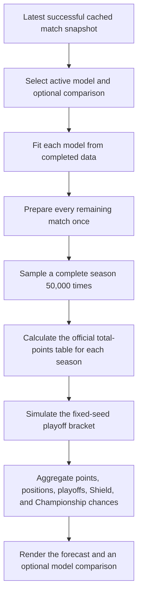
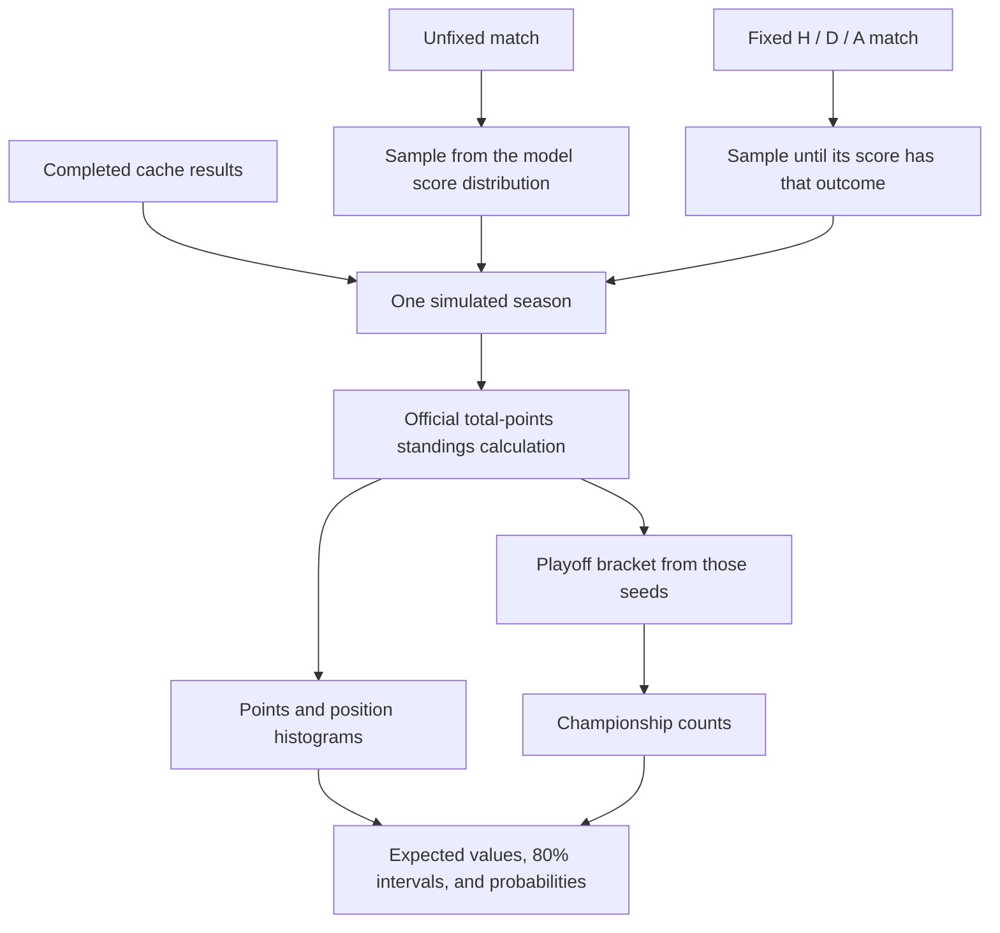

# How Forecast Lab works

This guide describes the current **Forecast Lab** implementation at
`/seasons/{season}/forecast`. It follows a forecast from the cached match
snapshot through a complete simulated season, explains what a fixed outcome
does, and draws a clear line between an outlook and a mathematical clinching
proof.

## The short version

Forecast Lab completes the season 50,000 times using one selected, versioned
forecast model. In every simulated season it preserves played results, samples a
score for every remaining cached match, calculates the regular-season table,
then plays the configured fixed-seed playoff bracket to a champion. It
aggregates both regular-season and Championship outcomes.

- Official standings contain only real completed results. A forecast is a
  model-based outlook, not an updated table.
- A fixed outcome is a visitor assumption that a particular home win, draw, or
  away win occurs. It is not a model prediction and it does not fix an exact
  scoreline.
- Every model runs against the same match snapshot, fixed outcomes, playoff
  place threshold, and number of simulations. A comparison shows how model assumptions
  change the outlook.
- The page is reproducible for unchanged input: its random seed is derived
  from the selected model, cached match data, and fixed assumptions.



The default model is currently **xG Poisson (schedule load)**
(`xg-poisson-schedule-load-v1`). It starts from the established xG Poisson
forecast, then adjusts the two teams' relative rates for exact recovery time
and accumulated load. The frozen adjustment passed the checked-in
development and final-test protocol; see [Model evaluation
v1](model-evaluation-v1.md).

## What Forecast Lab needs before it can run

Forecast Lab is a request-time calculation over the latest successful cache;
an ordinary page request does not call ASA or write a forecast back to SQLite.
It requires at least one cached match and validates the data it uses:

- teams and match IDs must be unique, and each match must reference known
  teams;
- completed (`FullTime`) matches must have non-negative scores;
- remaining (`PreMatch`) matches must not already have scores; and
- each fixed assumption must name a still-remaining cached match and use a
  valid home-win, draw, or away-win outcome.

Matches with other statuses are not invented into a season result. If the
cached match inventory does not match the configured regular-season size, the
forecast can still run, but the page warns that it includes only the matches
currently in the cache.

The xG model reads only validated, available ASA **team-model** xG for
completed matches. Missing xG is deliberately not substituted with actual goals.
Coverage and a separate xG-refresh timestamp are not displayed in Forecast Lab.

At server startup, the scheduler begins bootstrapping missing public historical
regular seasons. The two previous seasons needed by the venue-based models are
encountered first among the historical inputs, after current-season work. Those
historical runs persist teams, matches, xG, and compact venue summaries, but
skip qualification and scenario calculations because forecasts consume only
the historical home/away aggregate. Each successful match and xG write
updates the summary transactionally, so later forecasts read two small
aggregate rows rather than recalculating historical seasons on every request.
See [How synchronization works](sync-logic-guide.md) for the complete refresh
flow and terminology.

Explore's Match by match benchmarks reuse the default model's baseline forecast
with no fixed outcomes. Projected final points select its playoff and top-4
comparison groups; highest Shield probability selects its Shield favorite,
including all tied favorites. The comparison lines show those teams' recorded
match averages. Explore uses its existing cached archive snapshot and shares
Forecast Lab's executor and result cache. Projection failures leave comparisons
unavailable while preserving the rest of Explore; there is no current-standings
fallback. Completed-season groups and the Shield winner use factual standings.
See [the Explore guide](explore-guide.md#match-by-match) for coverage and membership rules.

## The model catalog

Every model has a stable ID. Changing its formula or constants requires a new
ID, so a shared URL always says which model produced its outlook.

| Model | ID | Completed-data input | Main assumption |
| --- | --- | --- | --- |
| Current pace | `current-pace-v1` | Scores and table points | A team's observed points pace directly scales its future scoring rate. It does not model opponent defense. |
| Results Poisson | `results-poisson-home-two-seasons-v1` | Scores | Current-season team attack and goals-conceded rates use league venue rates pooled with the two previous seasons. |
| xG Poisson | `xg-poisson-home-two-seasons-v1` | Available ASA team-model xG | The Results Poisson formula applies to available xG rather than goals; missing xG stays missing. |
| xG Poisson (recent form) | `xg-poisson-recent-form-v1` | Available ASA team-model xG and kickoff dates | An experimental alternative: each team's xG attack and defense discount older current-season matches exponentially, while the two-season league home-field baseline stays unchanged. |
| xG Poisson (schedule load) | `xg-poisson-schedule-load-v1` | Available ASA team-model xG, match kickoffs, and the two previous regular seasons | The selected xG Poisson model adjusts relative team strength for short recovery and a third match within nine elapsed days. |
| xG Poisson (npxG strength, schedule load) | `xg-poisson-npxg-strength-v1` | Available ASA team-model xG and penalty splits, match kickoffs, and the two previous regular seasons | The schedule-load model with team attack and defense rated on non-penalty xG; league scoring rates still include penalties. Available for comparison, not the default. |

All six models turn a match into independent home and away Poisson score
distributions. Their scoring rates are bounded between `0.20` and `4.50` goals
per side, which keeps sparse early-season data from producing implausibly
extreme scorelines.

### Results Poisson and xG Poisson

The two Poisson models share the same structure. For Results Poisson, let `M`
be completed matches from the current and two previous regular seasons, `HG`
and `AG` their home and away goals, and use the fixed league priors of 20
matches at 1.50 home goals and 1.20 away goals:

```text
league_home = (HG + 20 * 1.50) / (M + 20)
league_away = (AG + 20 * 1.20) / (M + 20)
league_rate = (league_home + league_away) / 2
```

For a team with `P` completed matches, `GF` goals for, and `GA` goals against,
the eight-team-match shrinkage produces:

```text
attack  = ((GF + 8 * league_rate) / (P + 8)) / league_rate
defense = ((GA + 8 * league_rate) / (P + 8)) / league_rate
```

`defense` is a goals-conceded multiplier, so a value above one raises an
opponent's expected scoring rate. For home team `H` and away team `A`:

```text
lambda_home = clamp(league_home * attack_H * defense_A, 0.20, 4.50)
lambda_away = clamp(league_away * attack_A * defense_H, 0.20, 4.50)
```

The simulator independently samples `Poisson(lambda_home)` and
`Poisson(lambda_away)`.

`xg-poisson-home-two-seasons-v1` uses this exact calculation with available
team-model xG in place of `HG`, `AG`, `GF`, and `GA`. Only completed matches
with available xG contribute to its fit. Historical xG affects only the league
home/away rates; each team's attack and defense still use the current season.
Incomplete xG coverage can make its outlook different from Results Poisson for
two reasons: the input values differ, and the model may have fewer observed
matches. It does not fall back to results.

### xG Poisson (recent form)

`xg-poisson-recent-form-v1` is a comparison model rather than the default. It
uses the same Poisson construction and league home/away rates as
the baseline xG Poisson model, but replaces each team's unweighted xG totals
with an exponentially weighted total. For a completed match `d` days before
the most recently completed match in the cached season:

```text
weight = 2^(-d / 60)
```

The match at the cutoff has weight 1; a match 60 days old has weight 0.5, and
one 120 days old has weight 0.25. The weighted xG-for, xG-against, and match
weight replace `GF`, `GA`, and `P` in the standard eight-match shrinkage
formula. This smooth decay has no date cliff and does not give an unevenly
scheduled team an arbitrary fixed number of “recent” matches. The 60-day
half-life is a deliberately fixed experimental constant, not a user control.
The checked-in historical evaluation found that it did not meet the
precommitted replacement rule: its final-test match log loss was slightly
worse than the default and the paired interval crossed zero. It remains an
available comparison model.

### xG Poisson (schedule load)

`xg-poisson-schedule-load-v1` is the selected default. It first calculates the
unclamped home and away rates from `xg-poisson-home-two-seasons-v1`. For each
team, recovery pressure is zero with at least six elapsed days since its prior
match, rises linearly between six and five days, and saturates at one with
five days or less. A separate accumulated-load flag is set when the current
match is the team's third or later appearance and its second-prior kickoff
was no more than nine elapsed days earlier.

For recovery pressure `r` and accumulated-load indicator `L`, the congestion
value is:

```text
congestion = 0.04 * r + 0.075 * L
adjustment = (away_congestion - home_congestion) / 2

lambda_home = clamp(base_home * exp(adjustment), 0.20, 4.50)
lambda_away = clamp(base_away * exp(-adjustment), 0.20, 4.50)
```

This symmetric form preserves the two base rates' geometric mean: equal load
cancels, while the more congested team becomes relatively weaker. FullTime and
PreMatch matches with valid UTC kickoffs establish the schedule; abandoned or
unsupported matches do not contribute. The constants were strongly shrunk
and frozen using development seasons before the model was evaluated once on
the held-out final-test seasons.

The standings indicator and Schedule difficulty page reuse this exact load
calculation. Their descriptive strength measure starts from venue-adjusted
opponent PPG and multiplies each match by
`exp(team_congestion - opponent_congestion)`. Thus the schedule becomes harder
when the evaluated team is more loaded, easier when its opponent is more
loaded, and unchanged when their load is equal. The venue-only and raw PPG
measures remain visible as comparisons.

Explore's opponent adjustment (`forecast.OpponentAdjustments`) applies this
model to completed matches, with an average team in place of the judged team
and the judged match left out of the fit. A test checks its factors and the
average team's expected points (from the same rates) against the fitted model,
before factors are normalized to average 1 across the season. See the
[Explore guide](explore-guide.md#match-by-match).

### xG Poisson (npxG strength, schedule load)

`xg-poisson-npxg-strength-v1` is offered in Forecast Lab and the model
evaluation but is not the default. It is `xg-poisson-schedule-load-v1` with team attack and defense
rated on non-penalty xG: ASA's penalty-kick xG is subtracted from each side of
every current and historical match, and the multipliers are measured against
the league npxG mean so they stay centred on one. The league home and away
scoring rates stay on all-shots xG, so simulated scorelines still include the
league's usual penalty goals. Priors, the two-season venue window, the clamp
and the schedule-load adjustment are unchanged. A match without an observed
penalty split is left out of team strengths, as a match without xG is.

The design was frozen after one development comparison. Two alternatives were
dropped: fitting the venue rates on npxG as well (which removes penalty goals
from simulated scorelines and was worse on match log loss), and keeping 25% of
penalty xG in team strengths (no better than 0%). First-half penalty xG
correlates only about 0.07 with second-half penalty xG across 2016–2025, against
about 0.55 for npxG.

Its one final-test run did not meet the replacement rule: final-test match log
loss was 0.0018 lower than the default, but the paired interval
[-0.0061, +0.0025] crossed zero, and Shield Brier and position RPS were
slightly worse. `xg-poisson-schedule-load-v1` remains the default. See
[the model evaluation](model-evaluation-v1.md).

Live forecasts take the league npxG venue rate from the prior-season venue
summaries, which derive npxG totals from stored penalty splits when read; the
npxG totals are used only when every prior-season xG match has a split.
Otherwise the npxG league rate comes from the current season alone. Backtests
pool the rate from cutoff-safe historical matches. Penalty splits and npxG
totals are part of the forecast result key, so a split that arrives after its
xG refreshes cached forecasts.

### Current pace

Current pace uses the same home-goal, away-goal, and 20-match priors to
establish baseline scoring rates. It then turns points per game into each
team's multiplier. With `TP` total points awarded in `M` completed matches:

```text
league_ppg = (TP + 40 * 1.35) / (2 * M + 40)
team_ppg   = (team_points + 8 * league_ppg) / (team_matches + 8)

lambda_home = clamp(league_home * home_ppg / league_ppg, 0.20, 4.50)
lambda_away = clamp(league_away * away_ppg / league_ppg, 0.20, 4.50)
```

It is intentionally simple: a team's own observed points pace affects its
rate, while the opponent's defensive record does not. The priors make all
three models usable before teams have completed a match.

## One simulated season

The simulator fits the selected model once, sorts matches by ID, and prepares
one score distribution for every remaining match. Each iteration then:

1. retains all completed cached results;
2. samples one scoreline for every remaining match, honoring any fixed
   outcome;
3. calculates a full table using the 2026 official total-points ordering; and
4. adds each team's points and finishing position to its aggregate; and
5. uses that table's seeds to play the configured playoff bracket and credits
   the winner with one Championship.

The official ordering uses points, goal difference, wins, goals scored,
head-to-head points, and head-to-head goals scored. If those accessible rules
cannot separate a tied group because the cache lacks disciplinary points, the
simulator gives each tied team an equal share of every position occupied by the
group. It therefore does not let a deterministic display fallback create a
spurious probability advantage.

The production default is 50,000 simulated seasons. The simulator checks the
HTTP request context at least every 100 iterations, so cancelled requests stop
instead of continuing to consume CPU. After verified regular-season completion, it
reuses the known final table and retains cached playoff advancement, sampling
only unresolved rounds. If final seeds or source advancement cannot be verified,
it retains the table and withholds championship odds.
A forecast without an eligible fixed bracket retains the single-table shortcut.

### Playoff assumptions

The [2026 competition rules](https://images.nwslsoccer.com/image/private/t_q-good/prd/tstudhfledlk7z8ygtzd.pdf)
define an eight-team bracket. Quarterfinals pair 1–8, 4–5,
2–7, and 3–6; the first two winners meet and the last two winners meet in the
semifinals. Published home/away assignments get the model's venue effect in those two
rounds; unpublished pairings give the higher seed home advantage. The Championship has a designated venue, so the model samples either
team as the nominal home side with equal probability. This removes a systematic
home assignment advantage; it does not attempt to model a team's actual travel
or local support at that venue. Unpublished venue changes in earlier rounds are not known in advance.
The model uses home/away assignment rather than stadium identity; it does not
adjust for a published stadium move, travel, or local support.

The model samples a 90-minute score for each playoff match. When that score is
tied, it chooses the advancing team according to the model's relative
90-minute win chances, normalized to exclude draws. This is an approximation
for extra time and penalties, rather than a separate extra-time or shootout
model. The selected forecast model is fitted to completed regular-season data
once. Playoff results do not refit it. Published playoff kickoffs remain available on the linked bracket page.
All playoff pairings use the underlying venue rates without recovery or
accumulated-load adjustments, including when dates are published. Applying
those adjustments would require modeling the full conditional playoff schedule
and load; this change does not introduce that model.

During the regular season, when accessible standings rules cannot separate a
tied seed group, each simulation randomly assigns that group's seeds. Every
tied team gets an equal opportunity without using display order as a tiebreak.
Once the regular season is complete, an unresolved playoff seed instead
withholds championship odds until the source can certify the bracket.



## Championship forecasting after the regular season

Forecast Lab remains in navigation after verified regular-season completion.
The postseason view leads with championship odds alongside the official final
regular-season points, resolved seeds, and settled qualification. It hides
regular-season projection intervals, the position heatmap, and empty scenario
controls. Unresolved ranks or qualification boundaries are labeled explicitly;
alphabetical display order never becomes an official seed. Models and optional
comparisons remain available. At 390px, team names stay pinned while the final
facts and comparison columns scroll horizontally.

If playoff matches are already cached while the regular-season snapshot still
contains pending results, championship odds are withheld until final standings
can be verified; stale regular data cannot restart observed playoff rounds.
The regular-season inventory and safe final results must be certified by the
same checks as the Playoffs handoff. The verified fixed bracket and resolved
final playoff seeds supply initial pairings even before ASA publishes fixtures.
The page explains that unpublished schedule details remain unknown: an empty
cache cannot establish whether ASA has published them. Partially published
fixtures are matched by participants using `bracket.BuildWithSeeds`, so source
publication order cannot move a match into another round.

Only completed (`FullTime`) playoff results with valid scores establish winners.
Unequal final scores include extra time; a tied score needs an explicit shootout
flag and paired, non-negative, unequal penalty tallies. Recorded winners advance
without resampling that match. Eliminated teams show exactly `0%`, and a
confirmed champion shows `100%`. A zero count from finite simulation alone is
still displayed as `<0.1%`.

A failed latest playoff refresh also withholds odds because published
advancement may be newer than the cache. Unknown or in-progress statuses,
missing scores, tied results without confirmed
advancement, invalid shootouts, unidentified played participants, duplicate
placements, incompatible matchups, or later-round games without known prior
winners withhold **all** championship odds. This intentionally conservative
boundary avoids allocating probability through uncertain bracket branches.
Final regular-season facts remain visible with an explanation and a link to the
source-backed bracket. Unplayed placeholders do not become matches or winners.
A partial inventory of otherwise valid upcoming or completed playoff matches
can still be used; unpublished slots are simulated only when there is no source
conflict or unresolved result.

The same postseason construction feeds HTTP forecasts and baseline warming.
Its canonical identity includes certified seeds, slot participants and winners,
and a digest of playoff source fields including statuses, scores, shootouts,
extra-time flags and kickoffs. It participates in both the random seed and
result-cache key; verified bracket format also participates in cache identity.
Current-season playoff source changes trigger warming alongside the existing
regular-season and historical inputs. All these reads use local SQLite only.
Postseason results do not enter model fitting or regular-season standings.

## Fixed outcomes are conditional scorelines

The page's **Scenario** section holds the assumption builder, with the applied
fixed results listed below it (or a note that every remaining match is
simulated). The builder accepts only an outcome: home win (`h`), draw (`d`), or
away win (`a`). It does not replace a match with an arbitrary canonical
score such as `1–0` or `0–0`.

Instead, the simulator samples from the selected match distribution until it
gets a scoreline with the required relationship. This is rejection sampling
from the model's conditional score distribution. It tries at most 10,000 times
as a defensive guard; the clamped positive scoring rates make hitting that
limit unexpected.

That distinction matters for goal-based and head-to-head tiebreakers. Even if
every remaining match is fixed as a win, draw, or loss, final positions can
remain uncertain because the model still samples plausible winning margins and
draw scores. Switching models preserves the fixed outcomes but can change those
conditional scoreline distributions.

## Reading the projected outlook

The page introduces the results with “Model estimates, not official standings.”
A **Forecast settings** disclosure starts closed on every page load, including
when a comparison is selected. Opening it directly exposes the active approach
and optional comparison selectors, the selected approach description, the Model
evaluation link, and counts for simulations, matches left, and fixed results.
There are no nested disclosures inside settings. Model choices keep applied
assumptions; without JavaScript, the same form has an Apply model choices button.

The outlook follows settings without a separate heading or introductory
instructions. Its caption identifies the active model, and each team row labels
its own Finish distribution disclosure. The Table | Heatmap selector is aligned
left at every width. The footer shows the data-update timestamp; there is no
extra timestamp, xG-coverage display, or Copy link button above the outlook.
Scenarios can still be shared using the page URL.

**Table** is the default outlook. A **Table | Heatmap** segmented selector
switches between the table and a league-wide finishing-position heatmap in the
same section. This is a local display choice: it does not navigate, run another
forecast, change assumptions or model choices, or alter the share URL. Returning
to Table preserves any expanded team distributions; unapplied assumptions also
stay in the builder. A new page load starts on Table. Without JavaScript, the
selector is disabled and the existing table and its disclosures remain usable.

### Table

Each row combines 50,000 internally consistent seasons; it is not a sequence
of independent per-match percentages.

| Value | Meaning |
| --- | --- |
| Projected points | Mean final points across simulated seasons. |
| 80% points interval | The 10th through 90th percentile final-points range. |
| Home playoff | Share of the position distribution that finishes first through fourth. |
| Playoffs | Share of the position distribution inside the configured playoff field. |
| Shield | First-place share of the position distribution. |
| Championship | Share of simulated seasons in which the team wins the playoff bracket. |
| Finish distribution | The 10th through 90th percentile finishing-position range and probability for every finishing place with non-zero probability. |

Exact `100%` and `0%` appear only for settled finishes: a proved clinch from
the standings' qualification run, a proved playoff elimination, or a points-only
elimination where enough teams already have more points than the team can
still reach. Playoff elimination also settles the top-four, Shield, and
Championship columns at `0%`. These proofs come from the real season, so they
still hold after fixing remaining results in a scenario, and they are shown only
when the qualification run for the current match snapshot completed.
Otherwise, a simulated share at or above 99.95% appears as `>99.9%`, and a share
below 0.05%, including zero simulated seasons, appears as `<0.1%`.

Expand a team's finish distribution to see positions in ascending order, with a
compact horizontal bar and the exact probability for each position. The bars
share one scale across all teams in the displayed forecast. Its ceiling rounds
the largest position probability on the page up to the next 10 percentage
points (up to 100%); the small 0% and ceiling labels make that scale visible.
This keeps team comparisons consistent while allowing a certain finish to use
the full bar width.

The table is sorted by projected points, then playoff chance, then home playoff
chance, followed by a stable team name/ID order. The full finish distribution
is available from each team row, so the range of plausible finishes remains
visible without presenting an average finishing position as a literal outcome.
On phones rank and team stay pinned while the other columns scroll; the team
and projected-points columns are narrow enough that Playoffs fits beside them
at 390px.

### Finishing-position heatmap

The heatmap uses the active model's same simulated position distributions and
team order as the table, with a column for every finishing position. It does
not introduce an additional selected-team chart; individual distributions stay
in the table's expandable rows. Applied assumptions affect both views equally.

Playoff positions use teal and positions outside the configured playoff field
use amber. Both palettes use the same absolute 0–100% probability scale, rather
than scaling each row independently. Stronger shading means a higher chance.
Column labels and boundaries distinguish home-playoff places and the playoff
cutoff; first place is identified as the Shield without adding another color.

Every position stays visible, including rare and unsampled finishes. A positive
share below the display precision is labelled `<0.1%`; a blank cell means no simulated
finishes and is identified that way for screen readers. Neither is a proof that
the finish is impossible. The probabilities follow the forecast's existing
rounding, so displayed values may not sum to exactly 100%.

The heatmap scrolls horizontally on narrow screens while team labels stay
pinned, keeping every finishing position available on phones. Numeric labels
and the position headings supplement the color encoding without requiring
hover.

### Comparing models

An optional comparison runs the second selected model with the same teams,
matches, fixed outcomes, iteration count, and playoff rules. The table keeps
the active model as the main row and shows the comparison metrics plus
`active − comparison` deltas:

- expected-point deltas are shown to one decimal; and
- top-4, playoff, Shield, and Championship deltas are percentage points.

The models do not share forced random score samples. Each model has its own
deterministic seed because their score distributions are different. The
comparison is therefore about differing model assumptions, not a claim that
one model has proved the other wrong.

## Reproducible, shareable scenarios

Forecast Lab has two URL formats. The current canonical form is:

```text
?v=2&m={active-model-id}&c={comparison-model-id}&p={game-id}:{h|d|a}&p=...
```

- `v=2` identifies the encoding.
- `m` is required and selects the active model.
- `c` is optional, must be a different supported model, and selects a
  comparison.
- Each `p` fixes one remaining match. Generated links sort these values by
  match ID.
- At most 12 fixed outcomes are accepted. Malformed, duplicate, unknown,
  completed, or otherwise stale match assumptions return `400 Bad Request`.
  Stale assumptions receive an explanation and a relative recovery link to the
  latest forecast, preserving model choices and clearing fixed results.

The app continues to accept legacy version-1 Results Poisson links, but it
generates version-2 links. A bare `/forecast` chooses the catalog default;
generated share links always name their selected model so a future default
change cannot alter that scenario's model choice. The team selector is only a
presentation filter and is intentionally omitted from share, reset, model, and
assumption-removal links.

The random seed is the first eight bytes of a SHA-256 hash over the model ID,
sorted team IDs, sorted cached match IDs/statuses/scores, sorted fixed
outcomes, and model-specific fitted input. The xG models add their xG values;
date-sensitive models also add the relevant canonical kickoff schedule.
Display names, refresh times, raw payloads, and unused xG rows do not affect the
seed.

A URL preserves model choices and assumptions, **not** a historical source
snapshot. It always uses the latest successful cache. When a match later
completes or disappears, an assumption that names it becomes stale and the
link shows an explanation with a recovery path rather than silently
reinterpreting those assumptions.

## Forecasts are not clinching proofs

Forecast Lab asks, *what does this model expect over many plausible complete
seasons?* The clinching system asks, *is there any feasible completion that can
deny a stated season outcome?* They answer different questions:

| Forecast Lab | Clinching system |
| --- | --- |
| Samples a finite number of model-weighted seasons. | Searches feasible outcomes for a guarantee or a blocking completion. |
| Reports probabilities, averages, and uncertainty intervals. | Reports `clinched`, `not_clinched`, or explicitly `unresolved` proof status. |
| Depends on model inputs and assumptions. | Uses conservative outcome constraints and does not treat a forecast probability as proof. |
| Can show a >99.9% playoff chance without a guarantee. | Can prove a playoff place even if Forecast Lab assigns it a lower chance; Forecast Lab then shows `100%`. |

Use the [clinching guide](clinching-logic-guide.md) for the qualification
proof, its tiebreak boundary, and next-slate clinching conditions. Forecast
probabilities never replace those badges or conditions.

## Where to look in the code

- [`internal/forecast/catalog.go`](../internal/forecast/catalog.go) defines the
  six-model catalog and its current default.
- [`internal/forecast/current_pace.go`](../internal/forecast/current_pace.go),
  [`results_poisson.go`](../internal/forecast/results_poisson.go), and
  [`xg_poisson.go`](../internal/forecast/xg_poisson.go) fit the base score
  models. [`xg_poisson_schedule_load.go`](../internal/forecast/xg_poisson_schedule_load.go)
  adds the selected schedule adjustment, and
  [`xg_poisson_npxg_strength.go`](../internal/forecast/xg_poisson_npxg_strength.go)
  rates team strengths on non-penalty xG.
- [`internal/simulation/simulation.go`](../internal/simulation/simulation.go)
  prepares complete seasons, conditionally samples fixed outcomes, handles
  unresolved ties, and aggregates results. [`internal/simulation/playoffs.go`](../internal/simulation/playoffs.go)
  advances the configured bracket and samples knockout winners.
- [`internal/simulation/seed.go`](../internal/simulation/seed.go) creates the
  canonical deterministic seed.
- [`internal/forecaststate/state.go`](../internal/forecaststate/state.go)
  validates and canonicalizes the shareable scenario state.
- [`internal/app/forecast_handler.go`](../internal/app/forecast_handler.go)
  binds the latest cache, models, URL state, and page request; the companion
  template is [`internal/app/templates/forecast.html`](../internal/app/templates/forecast.html).

Behavior-level examples live in the tests under
[`internal/forecast`](../internal/forecast),
[`internal/simulation`](../internal/simulation), and
[`internal/forecaststate`](../internal/forecaststate), with page coverage in
[`internal/app/handler_test.go`](../internal/app/handler_test.go).
