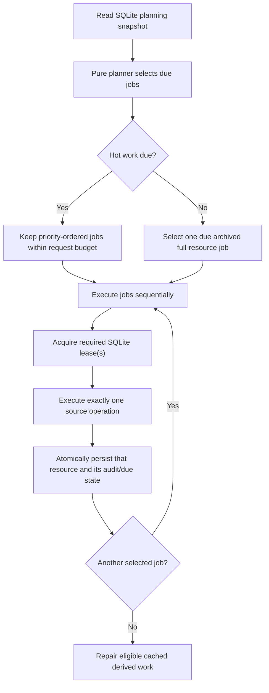

# How synchronization works

Ordinary web requests read the local SQLite cache only. ASA requests are made
by the background scheduler or an explicit `cmd/sync` maintenance command.
`cmd/sync` shares the server's `NWSL_DATA_DIR` and sync lease.
The scheduler does not run the former season-wide concurrent `Service.Run`
flow. Its immediate startup check also bootstraps missing public source-backed
catalog stages, while keeping current-season work ahead of that low-priority
archive loading.

[ASA source data](asa-source-data.md) lists the fields stored from each
endpoint and what uses them. [Competitions](competitions-guide.md) covers the
catalog of public stages this guide loads.

## Source data and derived data

- **Source data** is upstream-owned: the team catalog, match inventory and
  results, and match xG. Each source request has one owning cache mutation and
  its own audit and cadence state.
- **Derived data** is computed from cached matches: qualification and
  clinching scenarios. Recalculation reads the cache and does not contact ASA.
- **Forecast inputs** include matches and xG from the current regular season
  and the two preceding regular seasons. Missing public source-backed catalog
  stages are loaded by the startup scheduler; page reads still never make ASA
  requests to fill them.

## Historical regular-season cache reads

`cache.DB.HistoricalRegularSeasons` reads every public, source-backed,
`fixtures`-capable Regular Season catalog entry from one read-only SQLite snapshot.
It includes unloaded catalog years with nil readiness and empty match data, so
absence remains visible to archive callers. This is cache-only behavior: it
does not create source stages, update audit state, or introduce any refresh
work.

## Scheduler: pure planning, then sequential execution

On startup and each `NWSL_SYNC_CHECK_INTERVAL` tick, the scheduler reads one
consistent planning snapshot from SQLite. `scheduler.Plan` is pure: it uses the
snapshot, configuration, and a supplied clock to return an ordered batch of
due jobs. Planning does not make HTTP requests, acquire leases, or advance due
times.

Hot work takes precedence over archived correction work. Within the hot tier,
the planner orders jobs as follows:

1. authoritative games inventory when a stage is missing or not yet published;
2. one batched targeted-games request for due result checks in a stage;
3. authoritative full-stage xG when a published inventory has not yet had one;
4. one batched targeted-xG request for due completed matches in a stage; and
5. weekly authoritative inventory audits for in-progress or upcoming stages.

Missing public source-backed catalog stages are included in the bootstrap
inventory tier only until their first match inventory is observed. The
configured current primary stage comes first, followed by current secondary
stages in catalog order, historical primary stages newest first, then
historical secondary stages in catalog order. Historical stages use no format
assumptions, so the planner sends no expected team or match counts for them.
After inventory is available, initial xG loading proceeds independently; later
corrections use the archived sweep. A material targeted result in an incomplete
active bracket also makes its next full-games discovery due immediately; the
following scheduler tick performs that one collection request.

The default source-request budget is three operations per tick. Jobs beyond the
budget stay due because planning does not mutate their cadence state. Selected
operations execute sequentially; there is no concurrent teams/games/xG fetch
or single-target reconciliation path.

At server startup only, the scheduler drains an otherwise due public catalog
bootstrap in additional normal-budget batches separated by five seconds. That
includes missing match inventory and each stage's first full xG load; it does
not accelerate routine result checks, correction work, or derived calculations.
The drain stops on a source failure, lease deferral, cancellation, or when the
next normally selected batch has no catalog bootstrap work. Normal five-minute
cadence then resumes.

Qualification and clinching calculations and post-refresh forecast warming run
on their own budgets rather than the short source-request deadline, but they
remain owned by the scheduler. On server shutdown the scheduler cancels an
in-flight ASA request, calculation, or warm-up instead of waiting for its
budget. A canceled calculation publishes nothing. In contrast, an expired
budget still publishes its budget-limited batch for a later retry. Interrupted
work runs again after restart. Lease releases still complete during shutdown.
The scheduler's lifetime is attached with
[`internal/lifetime`](../internal/lifetime/lifetime.go).

### Independent result and xG cadence

Games and xG are independent resources with independent full and per-match
check state. A targeted operation sends all selected IDs for one resource and
stage in one request; an omitted ID is a checked observation, not a deletion.

| Work | Default cadence and window |
| --- | --- |
| Unsettled result after kickoff plus completion grace | Every scheduler interval (normally 5 minutes) while due. |
| Terminal result correction | Every 6 hours for 3 days after kickoff. |
| Missing xG for a completed match | Every 5 minutes for 5 days after kickoff. |
| Available xG correction | Every 6 hours for 5 days after kickoff. |
| Active/upcoming full inventory audit | Every 7 days. |

Invalid or missing kickoffs are not turned into immediate targeted polling;
authoritative inventory reconciliation remains the safety net. Material match
changes in the configured current stage can trigger cache-only qualification
and scenario recalculation. Material match or xG changes in the current or
previous two regular seasons can warm forecasts. No-op, omitted, stale, or
failed source observations do not create derived work.

## Split source operations

`syncer.Service.Execute` performs exactly one source operation:

| Resource | Full mode | Targeted mode |
| --- | --- | --- |
| Teams | Fetches `/nwsl/teams` and upserts the independent catalog. | Not used. |
| Games | Fetches the authoritative season/stage collection and replaces that stage's inventory. | Fetches requested match IDs and updates only those checked matches. |
| Game xG | Fetches authoritative stage xG after match inventory exists. | Fetches xG for requested match IDs and updates only those checked values. |

The match xG operation also carries ASA's penalty-pattern breakdown, so the
app can show non-penalty xG (npxG) in Explore, league history, and match
results. After `/nwsl/games/xgoals` returns at least one row, the same
operation makes one more request,
`/nwsl/teams/xgoals?split_by_games=true&shot_pattern=Penalty`. Full mode filters
by season and stage. Targeted mode filters by stage and a `start_date`/`end_date`
window spanning the returned matches' UTC dates plus one day on each side, because
ASA's date-filter time zone is unverified; it never sends `game_id`, which that
endpoint answers with HTTP 500. The syncer accepts a match's split only when it
has exactly two rows for the match's home and away teams, the two rows mirror each
other (xG within 0.0001), all values are finite and non-negative, and each side's
penalty xG does not exceed that side's match xG. A rejected or missing split
leaves the stored split unchanged. A failed penalty request is absorbed: the xG
write proceeds, the operation succeeds, `-require-xg` is unaffected, and a WARN
exception with `nwsl.error.code` `sync.penalty_xg` is recorded. The source
operation span reports `nwsl.sync.penalty_games_accepted` and
`nwsl.sync.penalty_games_rejected`. The cache stores the split on `game_xg`
(schema 15); a nil split means "not observed" and never erases a stored one, and a
penalty-only difference updates the row without counting as a material xG change,
so forecasts, persisted venue summaries, and correction cadence are unaffected.
The league npxG venue totals used by forecasts are not persisted: reading a
venue summary derives them from the season's stored splits, so a split that
arrives after its xG is reflected without touching the summary row. Penalty
data adds no scheduler job, cadence, or check table. Existing caches gain splits
as xG rows are re-observed (for example `cmd/sync -backfill-catalog` or normal
correction polling).

The operation validates and maps the one ASA response before invoking its
resource-specific cache API. Full match inventory replacement retains a prior
complete inventory when an incoming known inventory is incomplete or uneven.
Targeted operations do not delete unrequested records. If a match write finds
unknown teams, the service refreshes the catalog once and retries the same
validated write without refetching matches.

When a response disagrees with the cache, these rules decide which copy wins:

- **Games**: a terminal match (`Abandoned`, or `FullTime` with both scores)
  replaces a nonterminal one and is never replaced by one. Two pre-match copies
  with different match details take the incoming copy, because ASA can omit
  `last_updated_utc` before kickoff. Otherwise the incoming row wins only with a
  strictly later `last_updated_utc`.
- **Empty inventory**: an empty full response is recorded as an observation but
  never deletes cached matches or publishes a stage.
- **xG**: an available value replaces an unavailable marker. A differing
  available value replaces a cached one only when its observation finished
  strictly later than the cached check. Omission never erases an available
  value, and xG rows are deleted only with their parent match.
- **Materiality**: availability, xG, and expected-points changes are material;
  `raw_json`-only and timestamp-only changes are stored but trigger no
  downstream work.

Each operation persists its own success or failure audit and due state. A
failed request does not advance a successful observation or replace a durable
resource state. HTTP retries remain bounded by the per-operation request
deadline.

ASA occasionally uses paired `0-0` penalty scores with its penalties flag
false or absent as a no-shootout sentinel. The source mapper preserves raw JSON
but stores those two normalized scores as absent; it never infers a shootout or
winner. Lone, negative, and nonzero scores without `penalties=true` remain
rejected before a cache write.

## Leases and archived corrections

Before executing a hot job, the scheduler acquires a SQLite lease for that
stage. This serializes source writes across server and maintenance
processes. If the lease is unavailable, the job is deferred without an ASA
request.

Completed, available stages become eligible for cold correction sweeps only
after a successful full games observation. When no hot job is due, the planner
selects at most one due cold job: full games first, then full xG on a later
planner pass. Cold work has a 30-day default interval, staggered per stage.
It acquires a global cold-sweep lease followed by the stage lease, releasing in
reverse order. A material historical correction is reported so model-evaluation
evidence can be regenerated.

## Explicit sync and maintenance commands

The normal `cmd/sync` command is a forced selected-stage compatibility
sequence, not the scheduler's hot path. It conditionally refreshes teams,
then runs full games and full xG sequentially under the stage lease. It can
then run derived calculations for a stage with configured competition rules.

The maintenance modes are mutually exclusive:

- `-recalculate` runs qualification and clinching calculations from cached
  matches without contacting ASA.
- `-backfill-historical` force-refreshes supported historical regular seasons
  sequentially through the compatibility sequence. It remains useful for an
  operator-requested complete refresh, but is no longer required to populate
  missing historical catalog stages because startup does that incrementally.
- `-backfill-catalog` refreshes the teams catalog once, then every public
  source-backed stage sequentially in the same bootstrap priority order. It
  keeps non-configured stages source-only.
- `-sweep-due-archived` repeatedly takes fresh snapshots and runs due cold
  work until complete, deferred by hot work or a lease, or failed.
- `-prune-history-before` removes superseded operational history before the
  supplied RFC 3339 time.

`-force` asks derived calculations to run after the normal selected-stage
source sequence; it never bypasses source validation.

## Operational defaults

`NWSL_SYNC_TIMEOUT` defaults to `2m` and bounds one scheduler source operation
or one explicit selected-stage sync. `NWSL_SYNC_CHECK_INTERVAL` defaults to
`5m`; `NWSL_SYNC_COMPLETION_GRACE` defaults to `2h`. `NWSL_SYNC_SCHEDULER=false`
keeps the server from starting the scheduler at all, so it makes no ASA
requests and runs no derived repair; startup forecast warming, which reads only
the cache, still runs. Development worktrees use it to serve a copied cache.
The public configuration
table in [README.md](../README.md#configuration) is authoritative for
environment-variable defaults.

## Implementation map

- Pure job priority, batching, cadence, and cold selection:
  [`internal/scheduler/planner.go`](../internal/scheduler/planner.go)
- Scheduler ticks, budgets, leases, execution, and cache-only recalculation:
  [`internal/scheduler/scheduler.go`](../internal/scheduler/scheduler.go)
- One-resource ASA requests and cache mutations:
  [`internal/syncer/operations.go`](../internal/syncer/operations.go)
- Selected-stage compatibility and derived recalculation:
  [`internal/syncer/syncer.go`](../internal/syncer/syncer.go)
- Explicit command modes:
  [`cmd/sync/main.go`](../cmd/sync/main.go)
